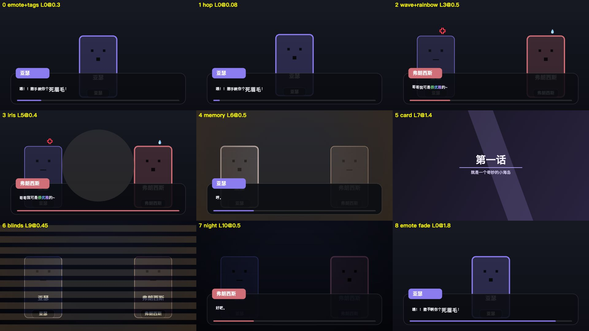
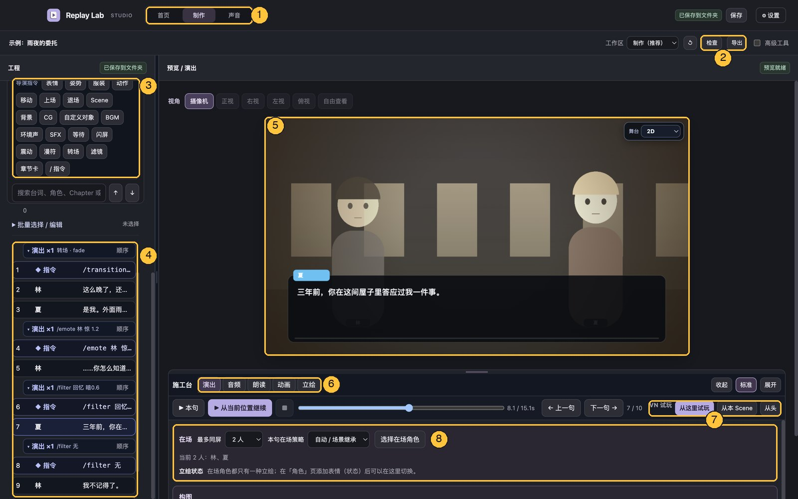
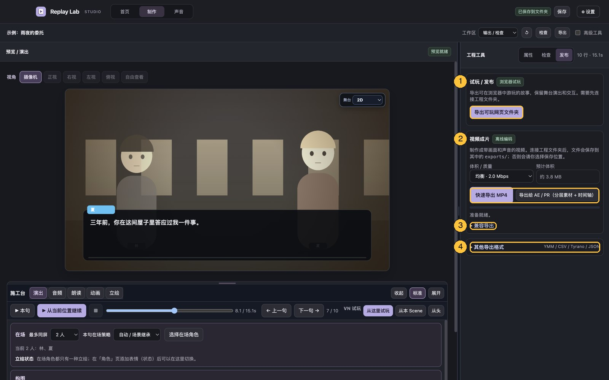

# Replay Lab

**把跑团 Log / 剧情台本，变成一集有配音、有演出的视觉小说式回放视频。**
在自己的电脑上运行：用本地 Voicebox 配音时不需要 API 额度，素材和声音不离开本机。¹

*A local, text-first TRPG replay studio: turn a session log or script into a voiced, staged visual-novel style video, with a director's workbench for AI voice takes.*

<!-- 介绍片：等决定放在哪里（Release 附件 / B 站 / YouTube）后，在这里放一张封面图链接到视频。 -->



> 标 † 的功能已经合并进 `main`，但还不在最新的安装包（v0.57.1-dev）里。想现在用，请[从源码运行](#从源码运行)，或者等下一个 Release。

## 它和别的工具有什么不同

舞台演出（对话框、转场、滤镜）这些，Ren'Py、Naninovel、RplGen 都做得很好，Replay Lab 只求够用。它真正想解决的是另外两件事：

- **AI 配音导演台。** 不是"点一下生成、不满意重来"，而是像录音棚收 take：每句保留历史版本、排队重 roll、生成完小红点提醒、整场连续审听、标记重录。每句可以单独写表演提示、选声音、选生成方式；还能把一句"念对了"的版本存成参考声音，让别的句子照着那个感觉念。
- **表里双语。** 屏幕显示一种语言、角色念另一种（例如字幕中文、配音日语），两条轨各自修改；中间可以用本地 LLM 或 LibreTranslate 翻译，也可以一键复制给任意 AI 网页再粘贴回来。

## 界面一览



| # | 区域 | 做什么 |
|---|---|---|
| 1 | 首页 / 制作 / 声音 | 首页新建、打开工程；制作是主要工作区；声音页选配音引擎（Free / Voicebox / 情绪桥）、设工程语言和角色声音，还有表里翻译和连续审听的审听台 |
| 2 | 检查 / 导出 | 检查工程（失效素材等）；导出打开右侧的发布面板（见下一张图） |
| 3 | 导演指令按钮 | 点一下插入对应的 `/指令`：表情、姿势、服装、动作、上下场、背景、CG、BGM、环境声、SFX、震动、漫符、转场、滤镜、章节卡… 左栏可以往上滚：上面还有保存位置、「导入 / 开始」（粘贴跑团 Log、导入文件或制作文件夹、导入转盘历史），以及剧本 / 角色 / 素材三个页签；往下是搜索和批量选择 / 编辑 |
| 4 | 台本列表 | 每行是一句台词或一条指令，点一行就选中它；「演出 ×1」把同一时刻生效的指令归成一组 |
| 5 | 预览 | 舞台实时预览；上面切换视角（摄像机、正视、俯视…），右上角切 2D / 2.5D |
| 6 | 施工台 | 调选中的这一句：**演出**（在场角色、立绘状态、构图、2.5D 镜头、上镜与站位）、**音频**（四条音量、自动闪避、各句声音的时间轴）、**朗读**（人声音量、选声音、重 roll、版本与提示词）、**动画**（影响这句的所有指令和调色滑杆，插入新效果，「声音…」选声音面板）、**立绘** †（视线、眼睛、眉毛、嘴巴） |
| 7 | 播放 / VN 试玩 | 播放本句或从当前位置继续；从这里、从本 Scene 或从头开始互动试玩 |
| 8 | 本句设置 | 跟着施工台页签变化，图里是「演出」页 |



| # | 区域 | 做什么 |
|---|---|---|
| 1 | 试玩 / 发布 | 导出能在浏览器里玩的网页文件夹 |
| 2 | 视频成片 | 快速导出 MP4；「导出给 AE / PR」† 输出分层素材和时间轴 |
| 3 | 兼容导出 | 实时录制 WebM |
| 4 | 其他导出格式 | YMM、CSV、TyranoScript、JSON 等 |

截图里的角色和背景是占位图。每个页签、右栏「属性」（本句的全部设置）、角色页、素材页、声音页和 VN 试玩的截图与逐项说明，见 **[功能总览 `docs/FEATURES_CN.md`](docs/FEATURES_CN.md)**。

## 功能

按制作顺序：写台本 → 配音 → 演出 → 导出。

### 写台本

| 方面 | 内容 |
|---|---|
| 导入 | CCFolia 日志（HTML）、RplGen RGL、纯文本、剧情台本、整个文件夹、转盘历史 |
| 台本写法 | `角色[情绪\|强度\|补充]：表文 \|\|\| 裏文` 一行写清情绪和朗读文本；在台本里插 `/指令` 做演出（见下面的速查表），左侧有快捷按钮 |
| 素材文件夹 | 把文件直接放进工程的 `assets/sfx`、`assets/bgm`、`assets/ambient`、`assets/characters`、`assets/backgrounds`、`assets/cg`，打开工程或点「刷新素材文件夹」就会加入素材库 |

### 配音

| 方面 | 内容 |
|---|---|
| 引擎 | 本地 [Voicebox](https://github.com/jamiepine/voicebox)（Qwen3-TTS 声音克隆）；可选「情绪桥」让克隆声音听从语气提示。另有浏览器内的 Replay Lab Free（Kokoro），第一次要联网下载模型，中文、日文效果一般 |
| 单句精修 | 版本历史、重 roll 队列、语气快捷菜单、角色设定 / 本句状态提示词、一个角色多个声音、口音（如英式 / 美式）、分段表演、语调曲线、参考句 |
| 音频 | BGM / 环境声 / 音效分轨、自动闪避、交叉淡化、打字音；「选声音」面板可以按文件夹浏览、搜索、试听，调音量 / 声像 / 延迟后挂到本句或插入 `/sfx` `/bgm` `/ambient` |

### 演出

| 方面 | 内容 |
|---|---|
| 舞台 | 自动上场与站位、说话人焦点与跳动、2D / 2.5D、镜头、打光与遮罩、自定义对象、转盘 / 骰子 / HP 条、气泡 / 聊天窗样式 |
| 立绘状态 | 从某一句起切换在场角色的立绘；台词情绪里出现设定好的词（例如「不满」），那一句自动换成对应立绘，和 `角色[情绪]` 写法直接连起来 |
| 服装 / 姿势 † | 和表情叠加的换装、换手型：`/outfit` `/pose`、姿势触发词、手可以画在脸前面；可以从 PSD 按图层名字导入 |
| 口型 † | TTS 不给音素时，按台词文本和音频能量自动对口型（日语假名、中文韵母、英语规则）；也能导入 `.lab` / Rhubarb |
| 立绘工作台 † | 拖动视线，眼 / 眉 / 嘴滑杆，网格变形；可以按句调，也可以存成表情默认 |
| 动画施工区 | 列出影响这一句的所有指令，原地修改，或在这句前面插入新效果 |
| 插件 † | 工程里 `plugins/*.js` 可以加导演指令、转场和滤镜；每个文件要你确认一次，改过内容会重新询问。写法见 [`PLUGINS_CN.md`](PLUGINS_CN.md) |

### 导出

| 方面 | 内容 |
|---|---|
| 视频 | 快速导出 MP4（离线编码）；兼容导出 WebM（实时录制） |
| 给 AE / PR † | 去掉对话框的画面 MP4、每句一张透明对话框 PNG、配音 / 音效 / BGM / 环境声分轨、SRT 字幕，以及 Premiere / 达芬奇能直接读的 FCP7 XML 时间轴 |
| 给 RPG Maker | 选中几句，把当前配音转成 RPG Maker MZ 能播放的 Ogg Vorbis |
| 可玩网页 | 导出成能在浏览器里打开的试玩文件夹 |
| 其他格式 | TyranoScript（台本级：背景、BGM、角色和台词，演出效果带不过去，素材要自己放进 Tyrano 工程）、YMM（纯文本台词）、CSV、Performance JSON、工程文本备份 |

现在没有：Ren'Py / Naninovel 工程导出，分支 / 选项 / 变量。

### 导演指令速查

| 指令 | 例子 | 说明 |
|---|---|---|
| 震动 | `/shake 强 2 随机` | 轻/中/强或像素数，固定或随机节奏，可跨好几句 |
| 闪屏 | `/flash white 0.3` | 黑 / 白 / 红或 `#颜色` |
| 漫符 | `/emote 亚瑟 怒 1.6` | 怒 汗 惊 问 惊问 省略 心 音符 闪 黑线 冒气 灵光 |
| 转场 | `/transition 圆开 1.2` | 切 淡入 溶解 左擦 右擦 上擦 下擦 圆开 圆收 百叶窗 碎点 |
| 滤镜 | `/filter 回忆` | 预设：回忆 夜晚 黄昏 黑白 梦境 暗角 危险；`/filter 无` 关闭 |
| 调滤镜 † | `/filter 回忆 暗0.7`、`/filter 自定义 色#ff8800 强0.35` | 预设后面跟参数就能改：亮 对 饱 色相 糊 色 强 暗 等 |
| 服装 / 姿势 † | `/outfit 亚瑟 衬衫`、`/pose 亚瑟 托腮` | 一直保持到下次切换，`default` 回默认；也可写 `/服装` `/姿势` |
| 章节卡 | `/card 第一话 "副标题" 3` | 全屏卡片，会停顿 |
| 其他 | `/bg` `/cg` `/bgm` `/ambient` `/sfx` `/enter` `/dismiss` `/move` `/motion` `/expression` `/object` `/camera` `/wait` | 背景、CG、音乐、环境声、上下场、动作、表情、对象、镜头、停顿。插件还能加新指令 |

台词里还可以加局部文字特效：`{抖}撒手啊{/抖}`、`{大}死眉毛{/大}`，以及 波 小 跳 彩 红 蓝 金 绿 灰。配音和翻译会自动忽略这些标记。

### 单句配音精修

在「施工台 → 朗读 → 重 roll、版本与提示词」：

- **分段表演**：按标点把一句切成几段，每段单独选语气、速度（变速不变调）和段后停顿，分别生成再拼接。适合"前半句平静、后半句爆发"。
- **语调曲线**：9 个点的音高起伏；可以只在本地弯曲现有版本的音高，也可以让情绪桥照着重录。
- **参考句**：把念对的一句存成参考声音，别的句子选用它，普通克隆会模仿它的语气；也可以设为角色默认声音。

## 安装（Mac，Apple Silicon）

安装包只有 Apple Silicon Mac 版。其他系统可以[从源码运行](#从源码运行)（没有充分测试）。

1. 到 [Releases](https://github.com/Coelum711/Replay-Lab/releases) 下载 `Replay-Lab-…-Mac-arm64.zip`，解压后把 `Replay Lab.app` 拖进「应用程序」。
2. 这个版本没有 Apple 开发者签名。第一次打开如果被拦，在「系统设置 → 隐私与安全性」里点「仍要打开」；或者在终端运行：
   ```bash
   xattr -dr com.apple.quarantine "/Applications/Replay Lab.app"
   ```
3. 配音需要另外安装 [Voicebox](https://github.com/jamiepine/voicebox)，在里面为角色建好声音（上传几秒到几十秒的干净录音），Replay Lab 默认连接 Voicebox（本机地址），一般不用改。详见 [`VOICEBOX_LOCAL.md`](VOICEBOX_LOCAL.md)。
4. 可选：想让克隆声音听从「生气」「拖长尾音」这类提示，安装情绪桥（运行 `INSTALL_VOICE_BRIDGE.command`，需要约 9 GB 模型）。详见 [`VOICE_BRIDGE_CN.md`](VOICE_BRIDGE_CN.md)。

> 提示：Voicebox 与情绪桥同时用 1.7B 模型时，显存吃紧的电脑可能会让 Voicebox 崩溃。批量生成时建议先跑完情绪桥的句子，再跑普通克隆的句子。

### 从源码运行

需要 Node.js 20 以上。

```bash
npm install
npm run build
npm run desktop
```

测试：`npm test`。打包 Mac 应用：`npm run package:mac`。

## 文档

- 功能总览（按界面逐项列出，带截图）：[`docs/FEATURES_CN.md`](docs/FEATURES_CN.md)
- 桌面版使用说明：[`DESKTOP_README_CN.md`](DESKTOP_README_CN.md)
- 实际制作流程：[`HUMAN_WORKFLOW_0.57_CN.md`](HUMAN_WORKFLOW_0.57_CN.md)
- 摄像机与施工台：[`CAMERA_WORKBENCH_0.57_CN.md`](CAMERA_WORKBENCH_0.57_CN.md)
- 语调曲线：[`PROSODY_0.56_CN.md`](PROSODY_0.56_CN.md)
- 音频工作台：[`AUDIO_WORKBENCH.md`](AUDIO_WORKBENCH.md)
- 灯光、滤镜与遮罩图层：[`LIGHTING_FILTERS_MASKS.md`](LIGHTING_FILTERS_MASKS.md)
- 2.5D 舞台：[`2_5D_STAGE.md`](2_5D_STAGE.md)；可交互对象：[`CUSTOM_OBJECT_INTERACTION.md`](CUSTOM_OBJECT_INTERACTION.md)
- 插件：[`PLUGINS_CN.md`](PLUGINS_CN.md)
- 更多专题见 [`docs/`](docs/)；历代版本说明与测试记录见 [`docs/history/`](docs/history/)

¹ 浏览器内的 Replay Lab Free 配音第一次要从网上下载 kokoro-js 和模型；翻译服务如果填的是远程地址，也会联网。

## 关于二创与 AI 配音

Replay Lab 只是工具，不附带任何角色、立绘或声音。用别人的作品或声音做二创时，请遵守原作与发布平台的规则，并在发布时标明使用了 AI 生成的配音。

## 许可证

[GPL-3.0](LICENSE)。部分功能移植自 [TRPG-Replay-Generator / RplGen](https://github.com/DanDDXuanX/TRPG-Replay-Generator)（GPL-3.0），其他第三方组件及其许可证见 [`THIRD_PARTY_NOTICES.md`](THIRD_PARTY_NOTICES.md) 与 [`licenses/`](licenses/)。
