# Replay Lab 功能总览

按界面逐块列出 Replay Lab 现在能做的事。依据是 `main`（c67a51c）的源码，以及在 Studio 里逐个打开每个页面、页签和折叠区读到的实际内容。截图里的角色和背景是占位图。

- 标 † 的功能已在 `main`，但不在最新安装包 v0.57.1-dev 里，要从源码运行。
- 「来源」一列写的是借用或移植了哪个开源项目，完整许可证见 [`THIRD_PARTY_NOTICES.md`](../THIRD_PARTY_NOTICES.md)。没写的是 Replay Lab 自己写的。

**规模**：TypeScript 核心约 100 个模块，Studio 前端约 40 个脚本，合计约 4.9 万行；42 个测试文件、400 多个测试。

目录：
[顶栏](#顶栏) ·
[左栏：工程](#左栏工程) ·
[预览](#预览) ·
[施工台](#施工台) ·
[右栏：属性](#右栏属性本句的全部设置) ·
[右栏：检查 / 发布](#右栏检查--发布) ·
[角色页](#角色页) ·
[素材页](#素材页) ·
[声音页](#声音页) ·
[VN 试玩](#vn-试玩) ·
[台本与指令](#台本与指令) ·
[看不见的部分](#看不见的部分导入导出与后台) ·
[来源](#借用的开源项目)

---

## 顶栏

| 位置 | 功能 |
|---|---|
| 首页 / 制作 / 声音 | 首页：新建工程、打开工程、最近的工程、找回上次的编辑备份。制作：主要工作区。声音：独立窗口，见[声音页](#声音页) |
| 保存 · 已保存到文件夹 | 保存到工程文件夹，状态实时显示 |
| ⚙ 设置 | 工程统一朗读语言、工程默认声音服务，跳到声音页 |
| 工作区 | 制作（推荐）/ 舞台 / 输出 · 检查 / 全部三栏 / 全部显示，切换布局 |
| ↺ · 检查 · 导出 | 刷新预览；打开右栏的检查页或发布页 |
| 高级工具 | 勾选后显示兼容层、精确参数和调试信息（RplGen 动效、精确混音、声像、Limiter 等） |

## 左栏：工程

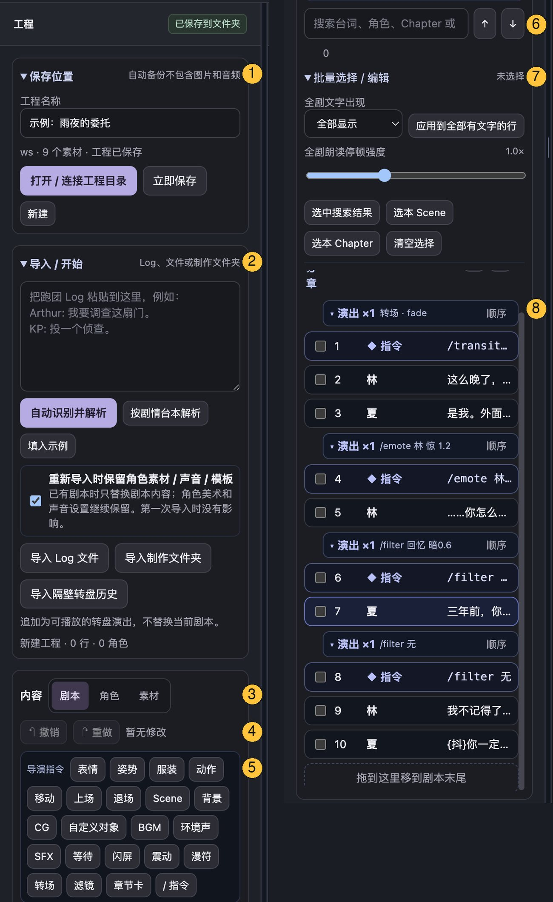

| # | 区域 | 功能 |
|---|---|---|
| 1 | 保存位置 | 工程名称；打开 / 连接工程目录、立即保存、重新载入目录版本、新建。自动备份只存文字，不存图片和音频 |
| 2 | 导入 / 开始 | 粘贴跑团 Log 后「自动识别并解析」或「按剧情台本解析」；填入示例；导入 Log 文件、导入制作文件夹、导入隔壁转盘历史（追加成转盘演出）；「重新导入时保留角色素材 / 声音 / 模板」只替换台词 |
| 3 | 内容页签 | 剧本 / 角色 / 素材，后两个见[角色页](#角色页)、[素材页](#素材页) |
| 4 | 撤销 / 重做 | 整个工程的编辑历史 |
| 5 | 导演指令按钮 | 表情、姿势 †、服装 †、动作、移动、上场、退场、Scene、背景、CG、自定义对象、BGM、环境声、SFX、等待、闪屏、震动、漫符、转场、滤镜、章节卡、/ 指令（手写）。点了会打开对应的结构化编辑器 |
| 6 | 搜索 | 搜台词、角色、Chapter，↑ ↓ 跳到上一个 / 下一个结果 |
| 7 | 批量选择 / 编辑 | 全剧文字出现方式、全剧朗读停顿强度；按搜索结果 / 本 Scene / 本 Chapter 选中；对选中的句子批量改角色、类型、文字出现、标点停顿、删除；把选中句的配音导出给 RPG Maker（.ogg） |
| 8 | 台本列表 | Chapter → Scene → 句子三层；连续的指令收成「演出 ×N」组，可设顺序或同时执行；勾选多选，拖动排序，拖到末尾移到剧本最后。长剧本用虚拟列表，不卡 |

## 预览

| 功能 | 说明 |
|---|---|
| 视角 | 摄像机（成片画面）、正视、右视、左视、俯视、自由查看；查看归中、采用查看角度 |
| 舞台 2D / 2.5D | 2.5D 下立绘有前后远近，背景保持平面 |
| 直接拖动 | 「可视化摆放」后在画面上拖角色位置；「调整镜头」后拖动画面取景 |
| 舞台效果 | 对话框、说话人名牌、说话跳动、焦点变暗、漫符、文字特效、转场、滤镜、打光、CG 遮罩、骰子 / 转盘 / HP 条、气泡 / 聊天窗 |

## 施工台

预览下方，调的是当前选中的这一句。顶部一排是播放：本句、从当前位置继续、停止、进度条、上一句 / 下一句、VN 试玩（从这里 / 从本 Scene / 从头）。右上角收起 / 标准 / 展开改变高度。

### 演出

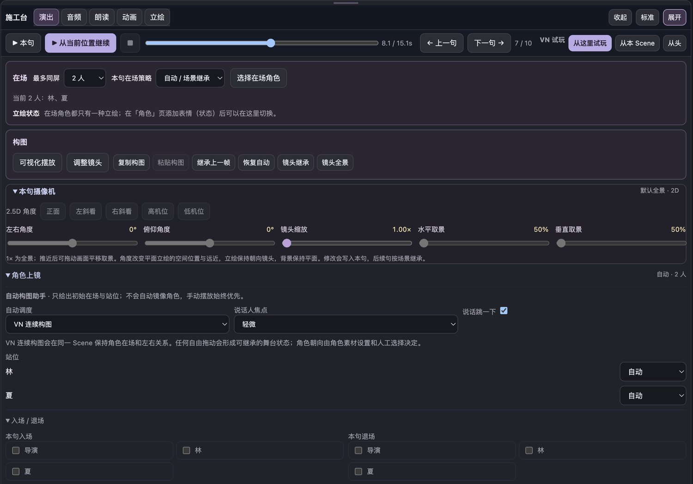

- **在场**：最多同屏几人、本句在场策略（自动 / 场景继承 / 手动），选择在场角色。
- **立绘状态**：从这句起切换在场角色的表情状态。
- **构图**：可视化摆放、调整镜头、复制 / 粘贴构图、继承上一帧、恢复自动、镜头继承、镜头全景。
- **本句摄像机**：2.5D 角度预设（正面、左斜看、右斜看、高机位、低机位），左右 / 俯仰角度、镜头缩放、水平 / 垂直取景。
- **角色上镜**：自动构图助手（自动调度、说话人焦点、说话跳一下），站位，本句入场 / 退场方式。
- **RplGen 兼容动效**（高级工具）：立绘切换方法和时长。来源：RplGen。

### 音频

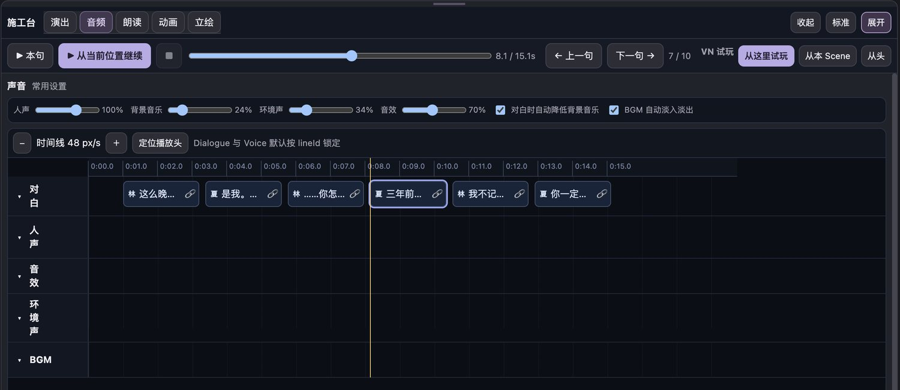

- **常用设置**：人声 / 背景音乐 / 环境声 / 音效四条音量；对白时自动降低 BGM；BGM 自动淡入淡出。
- **精确混音**（高级工具）：总音量、淡入淡出时长、输出保护（Limiter）。
- **时间轴**：每句台词和配音按 lineId 锁在一起，缩放、定位播放头，点一段跳到那句。

### 朗读

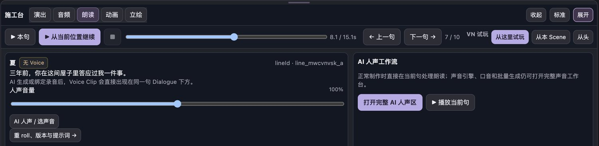

- 本句的人声音量；高级工具下有人声声像、人声延后、句前 / 句后停留。
- 「AI 人声 / 选声音」「重 roll、版本与提示词 →」跳到右栏属性里的配音区（见下面[右栏：属性](#右栏属性本句的全部设置)）。
- 「打开完整 AI 人声区」进声音页做批量生成和口音设置。

### 动画

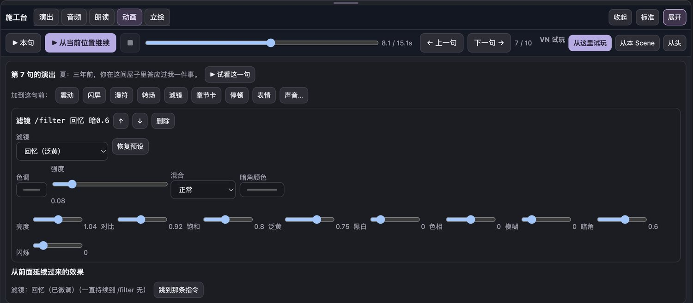

- **影响这一句的所有指令**：每条都能原地改参数、↑ ↓ 调顺序、删除；滤镜指令直接出现调色滑杆 †（色调、强度、混合、暗角颜色、亮度、对比、饱和、泛黄、黑白、色相、模糊、暗角、闪烁，可以恢复预设）。
- **加到这句前**：震动、闪屏、漫符、转场、滤镜、章节卡、停顿、表情、声音…（打开选声音面板：按文件夹浏览、搜索、试听，调音量 / 声像 / 延迟后挂到本句或插入 `/sfx` `/bgm` `/ambient`）。
- **从前面延续过来的效果**：例如「滤镜：回忆，一直持续到 /filter 无」，可以跳到那条指令。

### 立绘 †

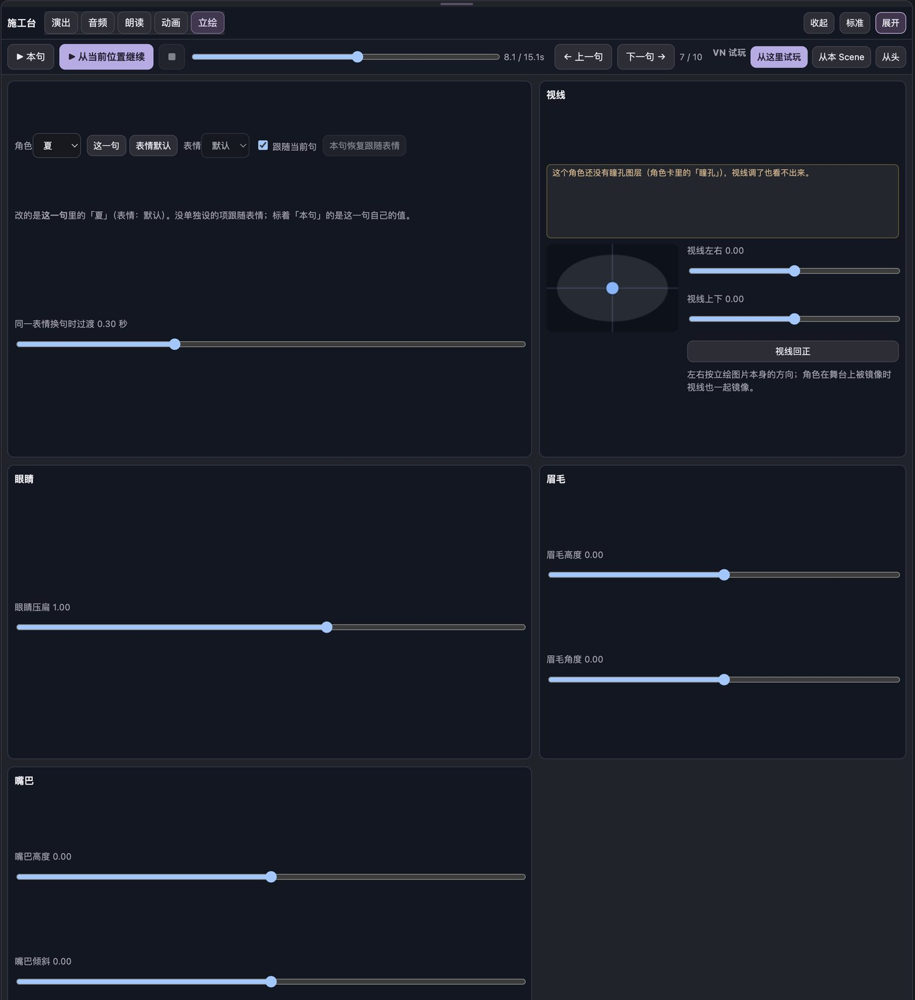

- 选角色，选改「这一句」还是改「表情默认」；本句恢复跟随表情；同一表情换句时的过渡。
- **视线**：左右、上下，视线回正（角色被镜像时视线跟着镜像）。
- **眼睛**：压扁。**眉毛**：高度、角度。**嘴巴**：高度、倾斜。
- 网格变形。概念来源：Inochi2D 的 LatticeDeformer（BSD-2-Clause）。

## 右栏：属性（本句的全部设置）

工作区选「全部三栏」或从朗读页点进来时出现。图分成三列，从左到右、从上到下。

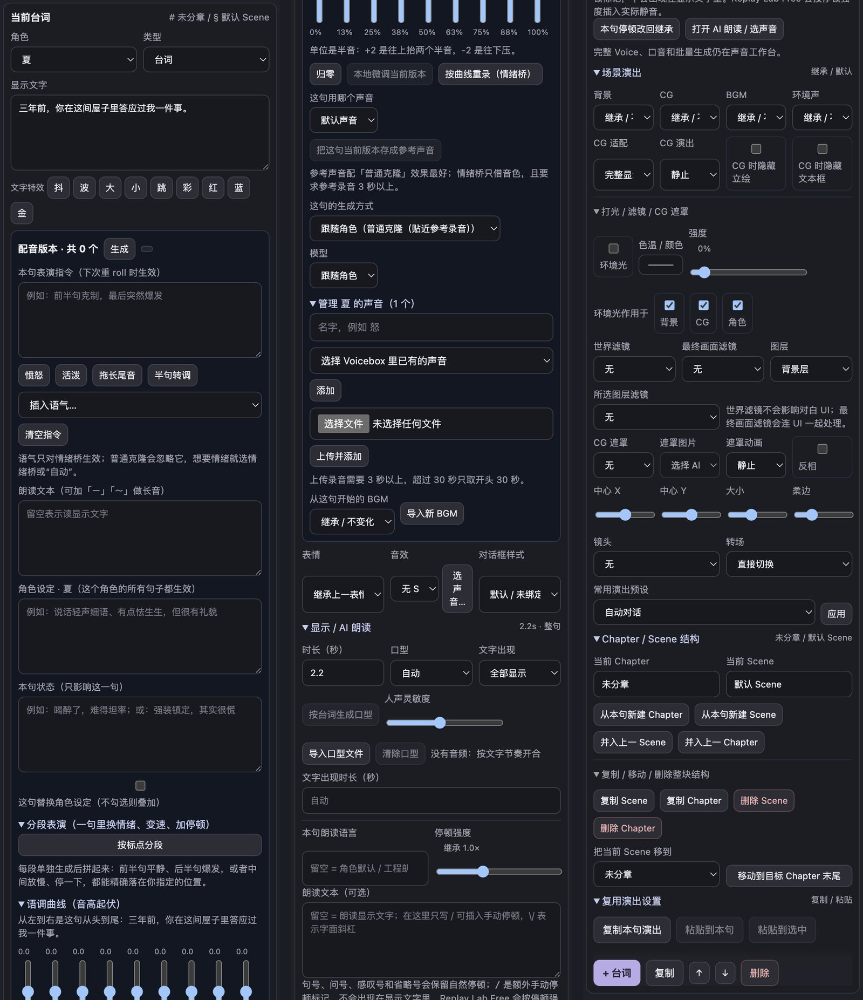

| 区域 | 功能 |
|---|---|
| 当前台词 | 所在 Chapter / Scene；角色、类型（台词、骰点、HP 演出、转盘、气泡 / 聊天窗、系统、旁白、导演指令）、显示文字；文字特效按钮：抖 波 大 小 跳 彩 红 蓝 金 |
| 配音版本 | 所有生成过的版本，生成 / 重 roll 队列 |
| 本句表演指令 | 下次重 roll 时生效：愤怒、活泼、拖长尾音、半句转调、插入语气…（情绪桥才听得懂） |
| 朗读文本 | 和显示文字分开，可加「ー」「〜」做长音 |
| 角色设定 / 本句状态 | 对这个角色所有句子生效的设定提示词，和只影响这一句的状态；可选「这句替换角色设定」 |
| 分段表演 | 按标点分段，每段单独选语气、速度（变速不变调）、段后停顿，分别生成再拼接 |
| 语调曲线 | 9 个点的音高（半音），本地微调当前版本，或按曲线让情绪桥重录 |
| 声音与生成方式 | 这句用哪个声音；把当前版本存成参考声音；生成方式（跟随角色 / 普通克隆 / 情绪桥…）和模型；管理这个角色的声音：从 Voicebox 选、上传录音（3–30 秒） |
| BGM · 表情 · 音效 · 对话框样式 | 从这句开始的 BGM（可导入新 BGM），表情，音效（选声音…），对话框样式 |
| 显示 / AI 朗读 | 时长；口型：自动 / 按台词生成口型 † / 导入口型文件（`.lab`、Rhubarb）/ 清除，人声灵敏度；文字出现（全部、逐字、逐行、滚动）和时长；本句朗读语言、停顿强度、朗读文本 |
| 场景演出 | 背景、CG、BGM、环境声的继承或切换；CG 适配、CG 演出，CG 时隐藏立绘 / 文本框 |
| 打光 / 滤镜 / CG 遮罩 | 环境光（色温、强度，作用于背景 / CG / 角色）；世界滤镜（不影响对话框）、最终画面滤镜、单图层滤镜；CG 遮罩：遮罩图片、动画、中心、大小、柔边、反相；镜头、转场；常用演出预设一键应用 |
| 高级转场 / 曲线 | 背景切换方式和时长，镜头节奏、转场节奏（缓动曲线来源：RplGen） |
| Chapter / Scene 结构 | 从本句新建 Chapter / Scene，并入上一个；复制、删除、移动整个 Scene / Chapter |
| 复用演出设置 | 复制本句演出，粘贴到本句或所有选中的句子 |
| 底部 | + 台词、复制、↑ ↓、删除 |

## 右栏：检查 / 发布

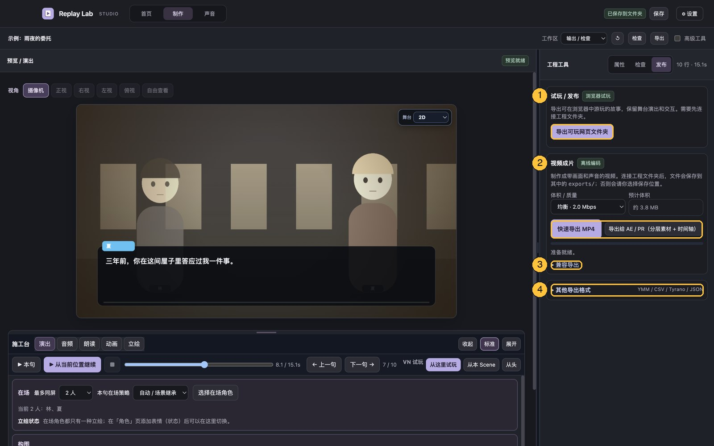

| 页签 | 功能 |
|---|---|
| 检查 | 工程检查：错误和警告（失效素材、结构问题等），重新扫描；高级工具下有当前编译状态 |
| 发布 · 试玩 / 发布 | 导出可玩网页文件夹，保留舞台演出和对象交互 |
| 发布 · 视频成片 | 体积 / 质量三档和预计体积；快速导出 MP4（离线编码，比实时快）；导出给 AE / PR †：无对话框画面 MP4、每句透明对话框 PNG、配音 / 音效 / BGM / 环境声分轨、两份 SRT、FCP7 XML 时间轴 |
| 发布 · 兼容导出 | 实时录制 WebM |
| 发布 · 其他导出格式 | Performance JSON、工程文本备份（JSON）、YMM 台本（纯文本）、CSV 台本、TyranoScript（台本级） |

## 角色页

左栏「内容 → 角色」。图是选中一个角色后，所有折叠区展开的样子，分成四列。

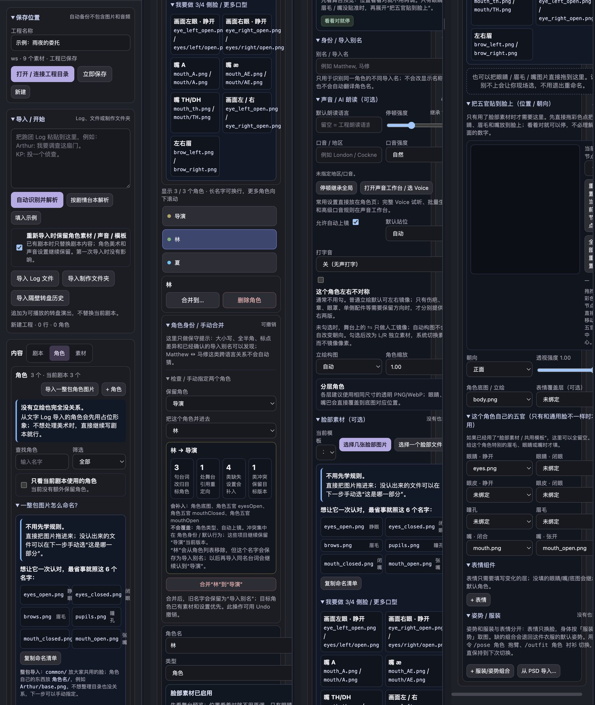

| 区域 | 功能 |
|---|---|
| 角色列表 | 查找、筛选、只看当前剧本用到的角色；+ 角色；导入一整包角色图片（按文件名自动认睁眼、闭眼、眉毛、瞳孔、闭嘴、张嘴，也支持 3/4 侧脸和更多口型，可复制命名清单） |
| 合并 / 删除 | 合并到另一个角色，旧名字保留为导入别名，以后再导入会自动认到一起；可撤销。只提示大小写、全半角、标点差异，不跨语言乱猜 |
| 基本信息 | 角色名、类型（普通、NPC、KP、系统）、导入别名 |
| 声音 / AI 朗读 | 默认朗读语言、停顿强度、口音 / 地区和口音强度；打开声音工作台选 Voice |
| 上镜 | 允许自动上镜、默认站位、打字音；「这个角色左右不对称」时分别提供左右两版而不镜像 |
| 立绘构图 | 角色缩放、构图 |
| 占位形象 | 没有立绘也能用：自动画名字长条、眼睛和嘴巴，口型和眨眼照常 |
| 脸部素材 | 选几张脸部图片或一个脸部文件夹；把五官贴到脸上：拖彩色点放眼睛、眉毛、嘴，调朝向和透视 |
| 分层角色 | 底图 / 立绘、表情覆盖层，以及这个角色自己的眼睛（睁 / 闭）、眼皮、瞳孔、眉毛、嘴（闭 / 张） |
| 表情组件 | + 表情，只填变化的层；表情触发词：台词情绪里出现某个词就自动换那一句的立绘 |
| 姿势 / 服装 † | 服装 × 姿势组合，每个组合多层（混合方式、透明度、画在脸前面）；默认服装 / 姿势、姿势触发词、预览；从 PSD 导入（按图层名字拆，读 PSD 用 ag-psd） |

## 素材页

左栏「内容 → 素材」。

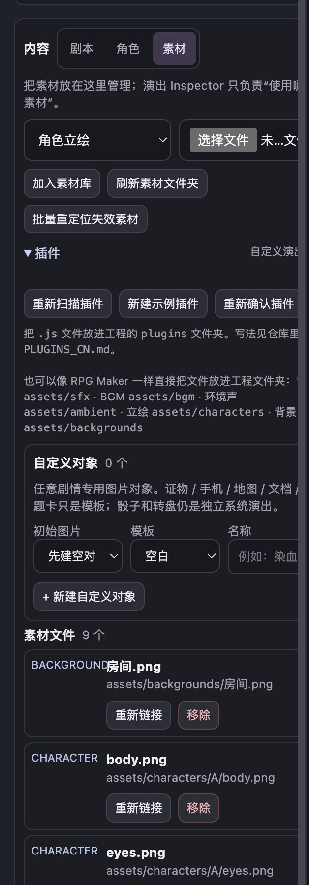

- **加入素材库**：选类型（角色立绘、背景、CG、BGM、环境声、音效…）后选文件。
- **刷新素材文件夹**：文件直接丢进 `assets/sfx`、`assets/bgm`、`assets/ambient`、`assets/characters`、`assets/backgrounds`、`assets/cg` 就会出现。思路借自 RPG Maker。
- **批量重定位失效素材**：选一个文件夹，按文件名批量找回。来源：RplGen。
- **插件 †**：重新扫描、新建示例插件（爱心飘落、爱心转场、老电视滤镜）、重新确认插件。每个文件按内容哈希确认一次，写法见 [`PLUGINS_CN.md`](../PLUGINS_CN.md)。
- **自定义对象**：证物、手机、地图、文档、标题卡等模板，任意图片做成可以在舞台上摆放、交互的对象。
- **素材文件**：每个文件可以重新链接或移除。

## 声音页

顶栏「声音」打开独立窗口，和 Studio 共用同一个工程。图分成三列。

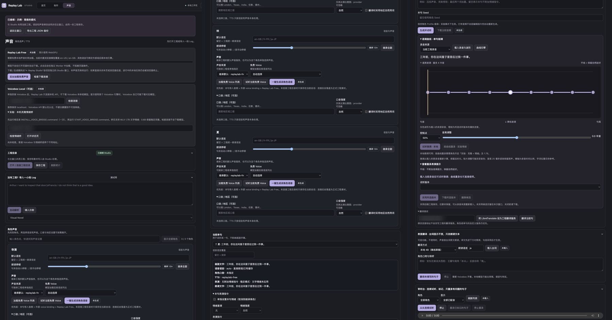

| 区域 | 功能 |
|---|---|
| 已接续 | 返回主窗口、导出工程 JSON 备份 |
| Replay Lab Free | 浏览器内 Kokoro 配音（英语为主），后台加载、取消、重新下载、用 WASM 重试、检查下载连接。第一次要联网下载模型 |
| Voicebox Local | 填地址、检查连接（默认连本机） |
| 实验：本机克隆情绪桥 | 检查情绪桥、打开状态页（默认连本机） |
| 工程目录 / 导入一小段 Log | 连接目录、保存、刷新统计；没工程时快速导入测试 |
| 工程语言与声音 | 统一朗读语言、默认声音服务 |
| 角色声音 | 每个角色：默认语言、朗读停顿、声音来源和 Voice、试听、一键生成该角色所有句子；口音 / 地区、口音强度 |
| 当前单句 | 本句表演指令、生成并试听、下载音频；语调曲线：载入录音与波形、试听微调、按曲线重录；查看重录候选：采用、下载、删除 |
| 翻译测试 | 把 LibreTranslate 设为工程翻译服务，翻译当前句 |
| 表里翻译 | 显示文字不变，只改朗读文本：载入台词、用本地模型翻译未填写的句子，或复制这批提示词给任意 AI 网页、再导入译文，勾选后采用 |
| 审听台 | 从头连续试听、标记有问题的句子、只重录标记过的 |
| 调试 | Performance JSON |

## VN 试玩

施工台「从这里试玩 / 从本 Scene / 从头」打开。

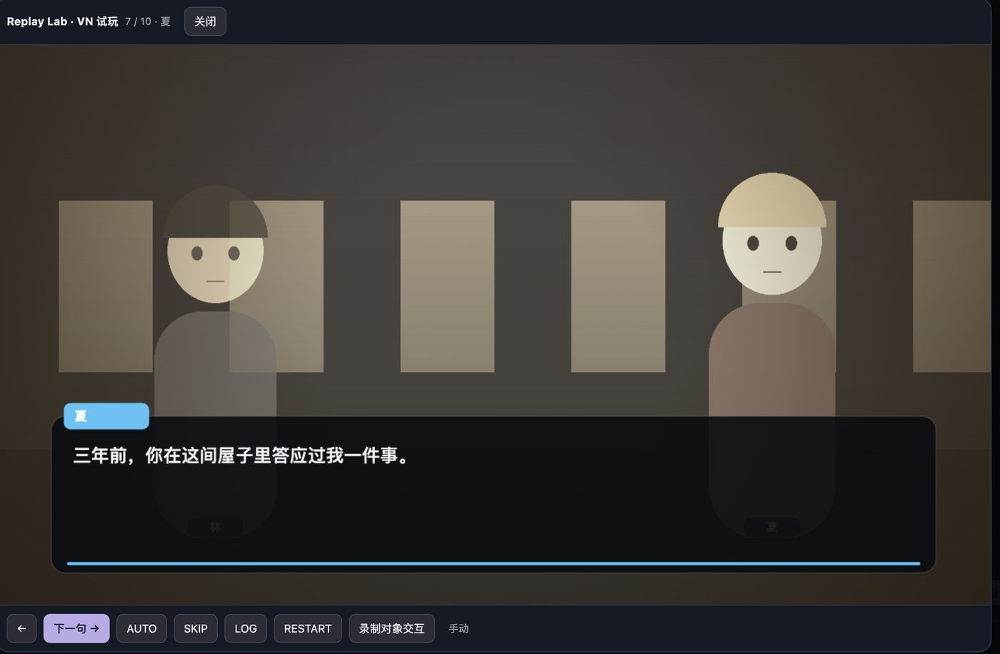

下一句 / 上一句、AUTO、SKIP、LOG（回看）、RESTART；可以点舞台上的自定义对象；「录制对象交互」把试玩时点过的对象录成普通的导演指令。导出可玩网页文件夹时用的也是这一套。

---

## 台本与指令

**一行写法**：`角色[情绪|强度|补充]：表文 ||| 裏文`。情绪也会喂给立绘触发词和姿势触发词。

**导演指令**（24 种）：`/enter` `/dismiss` `/move` `/motion` `/expression` `/pose`† `/outfit`† `/bg` `/cg` `/object` `/bgm` `/ambient` `/sfx` `/camera` `/transition` `/scene` `/chapter` `/wait` `/flash` `/shake` `/emote` `/filter` `/card`，加上插件注册的指令 †。大多数有中文别名（如 `/服装` `/姿势`）。

| 类别 | 可选值 |
|---|---|
| 漫符（12） | 怒 汗 惊 问 惊问 省略 心 音符 闪 黑线 冒气 灵光 |
| 转场（11） | 切 淡入 溶解 左擦 右擦 上擦 下擦 圆开 圆收 百叶窗 碎点，插件可加 |
| 滤镜（7 个预设 + 自定义） | 回忆 夜晚 黄昏 黑白 梦境 暗角 危险；每个都能接参数 †，如 `/filter 回忆 暗0.7`、`/filter 自定义 色#ff8800 强0.35` |
| 震动 | 轻 / 中 / 强或像素数，固定或随机节奏，可跨多句 |
| 文字特效（9） | `{抖}` `{波}` `{大}` `{小}` `{跳}` `{彩}` `{红}` `{蓝}` `{金}`，以及绿、灰；配音和翻译会忽略这些标记 |
| 文字出现（4） | 全部显示、逐字、逐行、滚动（和 RplGen 一致） |

没有时长的指令（表情、音效、漫符、上下场、滤镜、姿势…）占 0 秒，不会让对白框断一帧 †。

## 看不见的部分：导入、导出与后台

| 方面 | 内容 | 来源 |
|---|---|---|
| 导入格式 | CCFolia 日志 HTML、RplGen RGL（含 MediaDef 素材定义）、纯文本 Log（去掉时间戳和频道标签）、剧情台本、通用 JSON、整个制作文件夹、转盘历史；自动按内容和扩展名判断格式 | RGL / MediaDef 兼容 RplGen；CCFolia 解析参考 ccfolia-chatlog-formatter 的 HTML 结构 |
| 角色名识别 | 保守合并同一角色的不同写法，导入别名 | — |
| 口型 † | 按台词文本 + 音频能量生成：日语假名、中文韵母、英语规则；导入 `.lab`、Rhubarb | `.lab` 时序和音素分组移植 KuchiPaku（MIT）；按文本 + 能量对齐和英语规则移植自作者自己早先的 Lip Studio / LipSync Studio 小工具 |
| 配音 | Voicebox（Qwen3-TTS 克隆）、情绪桥、Kokoro；版本历史和重 roll 队列（一次只跑一个）；参考句；分段表演拼接；标点停顿；输入没变就不重算 | 情绪桥基于 mlx-audio（MIT）+ Qwen3-TTS（Apache-2.0）；语调曲线的本地变调用 SoundTouchJS |
| 口音 | 按语言和地区挑选 Voice、改写口音提示 | — |
| 翻译 | 本地 LLM（经 Voicebox）、LibreTranslate、复制 / 粘贴给任意 AI 网页 | — |
| 渲染 | Canvas 2D 舞台；2.5D 投影和前后排序；VN 运行时（AUTO / SKIP / LOG） | 动效和缓动移植 RplGen；VN 控制参考成熟的网页 VN 引擎 |
| 导出编码 | MP4 离线编码；Ogg Vorbis（RPG Maker）；FCP7 XML | Mediabunny；wasm-media-encoders |
| 工程安全 | 崩溃恢复（只存文字）；多窗口写入加锁；工程被外部改动时提示冲突；旧版工程自动迁移 | — |
| 插件安全 † | 每个插件文件按内容哈希确认，改过就重新询问 | — |
| 其他 | 长台本虚拟列表；可选 VNVE 适配（不打包 VNVE 代码） | TanStack Virtual；VNVE（MIT） |

## 借用的开源项目

| 项目 | 许可证 | 用在哪里 |
|---|---|---|
| [TRPG-Replay-Generator / RplGen](https://github.com/DanDDXuanX/TRPG-Replay-Generator) | GPL-3.0 | RGL 和 MediaDef 导入、立绘切换和动效、缓动曲线、文字出现方式、批量重定位素材 |
| [KuchiPaku](https://github.com/InuInu2022/KuchiPaku) | MIT | `.lab` 口型时序、音素到口型的分组 |
| [Inochi2D](https://github.com/Inochi2D/inochi2d) | BSD-2-Clause | 网格变形的思路 |
| ag-psd | MIT | 读 PSD † |
| [Mediabunny](https://github.com/Vanilagy/mediabunny) | MPL-2.0 | MP4 编码和封装 |
| [wasm-media-encoders](https://github.com/arseneyr/wasm-media-encoders)（含 libvorbis / libogg） | MIT（BSD-3-Clause） | Ogg Vorbis 编码 |
| SoundTouchJS | MPL-2.0 | 语调曲线的本地变调 |
| [Kokoro / kokoro-js](https://github.com/hexgrad/kokoro) | Apache-2.0 | Replay Lab Free 配音（运行时从 CDN 加载，不打包模型） |
| [TanStack Virtual](https://github.com/TanStack/virtual) | MIT | 台本虚拟列表 |
| [ccfolia-chatlog-formatter](https://github.com/y-8-m/ccfolia-chatlog-formatter) | MIT | CCFolia 日志 HTML 的解析参照 |
| [VNVE](https://github.com/vnve/vnve) | MIT | 可选适配（不打包 VNVE 代码） |
| mlx-audio · Qwen3-TTS · [Voicebox](https://github.com/jamiepine/voicebox) | MIT · Apache-2.0 · 见其仓库 | 情绪桥和配音后端（另装，不打包） |

另有 Electron 44（MIT）和 Chromium 组件随桌面版分发。完整条款以 [`THIRD_PARTY_NOTICES.md`](../THIRD_PARTY_NOTICES.md) 和 [`licenses/`](../licenses/) 为准。
